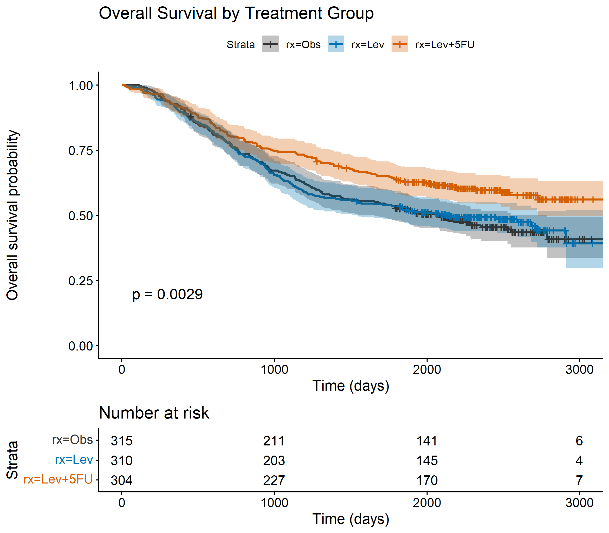
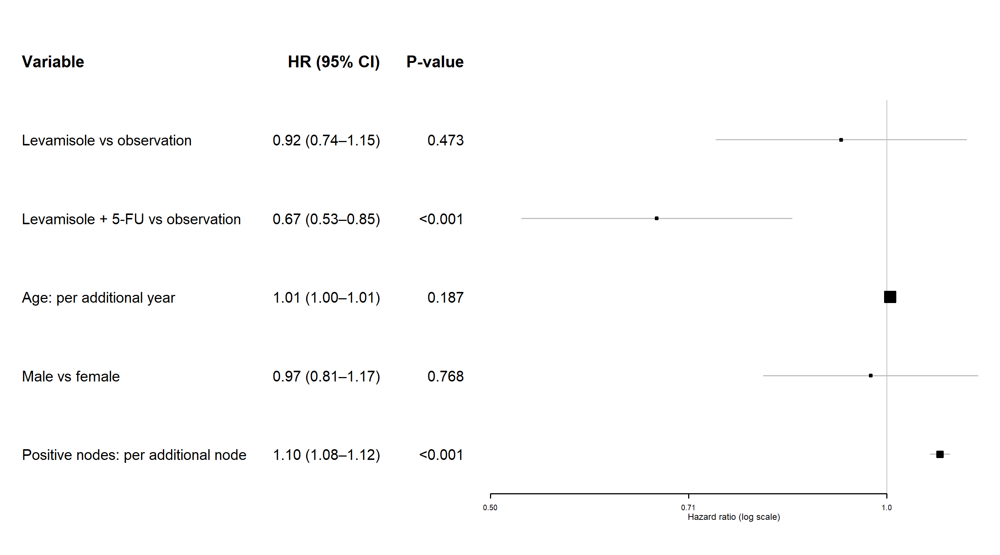
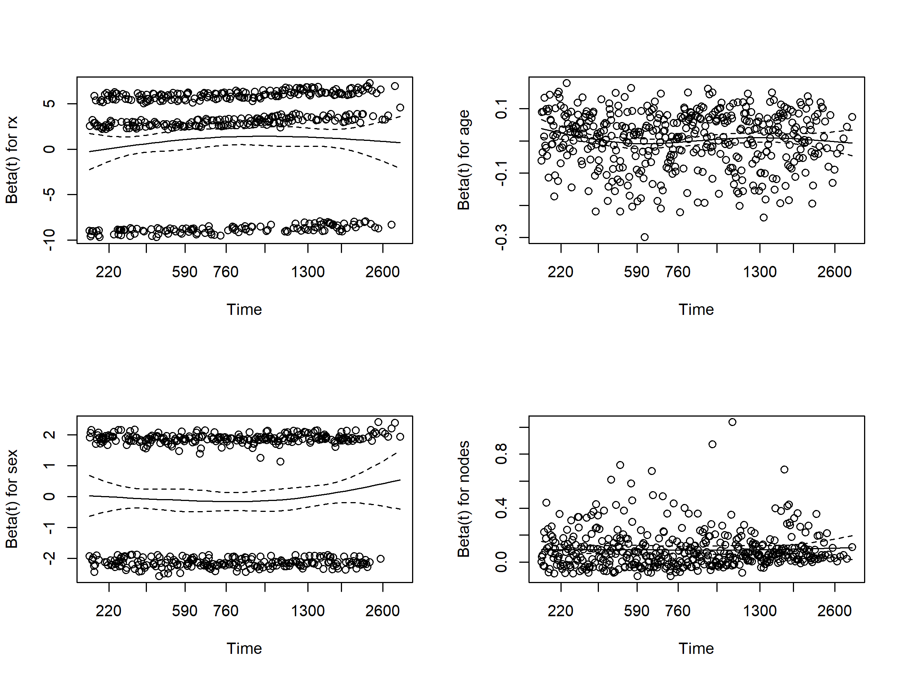

## Overview

This beginner portfolio project reanalyses the colon dataset from the R survival package. Overall survival is analysed using death records only (etype = 2).

## Methods

The workflow uses Kaplan-Meier estimation, log-rank tests and Cox proportional hazards regression. The adjusted model includes treatment, age, sex and the number of positive lymph nodes.

## Results and interpretation

```{r summary-text, echo=FALSE}
summary_lines <- readLines("03_OUTPUTS/tables/clinical_summary.txt")
cat(paste(summary_lines, collapse = "\n"), sep = "\n")
```

## Overall survival by treatment

```{r treatment-figure, echo=FALSE, out.width='100%'}

```

## Adjusted Cox estimates

```{r cox-table, echo=FALSE}
cox_table <- read.csv("03_OUTPUTS/tables/cox_results.csv")
cox_table$P_Value <- format.pval(cox_table$P_Value, digits = 3, eps = 0.0001)
knitr::kable(cox_table, digits = 4)
```

```{r forest-figure, echo=FALSE, out.width='100%'}

```

## Proportional-hazards diagnostics

```{r ph-table, echo=FALSE}
ph_table <- read.csv("03_OUTPUTS/tables/ph_assumption_results.csv")
knitr::kable(ph_table, digits = 4)
```

```{r ph-figure, echo=FALSE, out.width='100%'}

```
